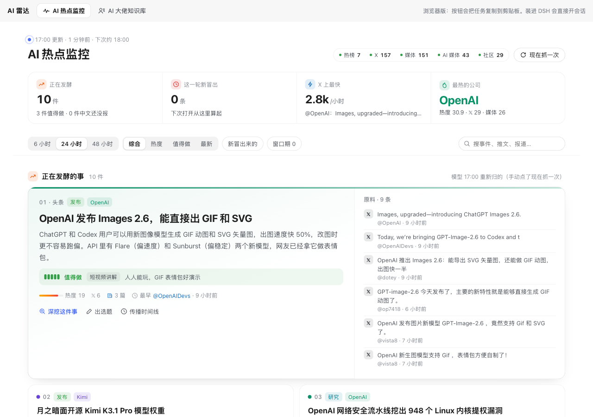
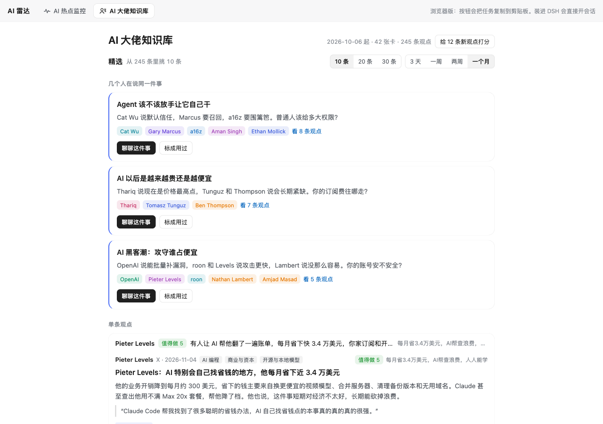

# AI 雷达 · DSH 插件：AI 热点监控 + AI 大佬知识库

给 [DeepSeek Harness（DSH）](https://www.npmjs.com/package/@deepseek-ai/dsh) 左栏加两个页面，做 AI 内容的人每天先看这两页再决定写什么：

- **AI 热点监控**：抖音、B站、百度、知乎、头条热榜上的 AI 词，X 上大V、官方号、核心开发者近 48 小时的帖，量子位、机器之心、新智元和 360 新闻的报道，Hacker News、Hugging Face、GitHub 上正在热的项目，几处放在一起看。模型把这些原料归成 6–12 件「正在发酵的事」，每件给热度、值不值得做（1–5 分）和适合做成什么形式。还能看传播时间线：源头几点发的、中文晚了几小时跟上，源头已经热了、中文还没人报的就是窗口期。
- **AI 大佬知识库**：自动抓 60 位 AI 大佬的博客、播客字幕和 X 推文，模型做成一张张中文知识卡片，每张有一句话、核心观点、原话加翻译、数字和事实、能拿来做什么。原话逐条回原文核对，核不到的会标出来。页面默认只给精选 10/20/30 条：先放几个大佬都在说的同一件事，再放单条高分观点。

每件事、每条观点都带两个按钮：「深挖」和「出选题」。在 DSH 里点一下会开一个新会话，把整理好的任务填进输入框，发不发由你自己点。

没装 DSH 也能用，浏览器打开 `http://127.0.0.1:8790` 是同样的两页，按钮改成把任务复制到剪贴板，贴进任何 AI 对话都行。




## 快速开始（5 分钟）

要求：Python 3.9 以上（macOS 自带的就行），**不用装任何 pip 包**。

```bash
git clone <这个仓库> dsh-ai-radar && cd dsh-ai-radar
cp config.example.json config.json
```

打开 `config.json`，把 DeepSeek 的 API key 填进 `llm.api_key`（或者设环境变量 `DEEPSEEK_API_KEY`），再把 `me` 改成一句话介绍你自己。key 在 [platform.deepseek.com](https://platform.deepseek.com) 申请。

```bash
python3 -m radar doctor        # 检查模型通不通、各个来源抓不抓得到
python3 -m radar hot           # 先抓一轮热点（1–2 分钟）
python3 -m radar cards run     # 先做一批卡片（抓最近 3 天，最多做 25 张，十来分钟）
python3 -m radar serve         # 起服务器，浏览器打开 http://127.0.0.1:8790
```

`serve` 开着就会按时自动跑：热点每小时抓一轮（凌晨 1–8 点不抓），卡片每天 7:40 做一次，给观点打分、归议题每天 9:30 做一次，时间都在 `config.json` 的 `schedule` 里改。想开机就在后台跑，可以照 [docs/launchd.md](docs/launchd.md) 配一下（macOS）。

## 装进 DSH

插件在 `plugin/` 目录。下面以 DSH 默认的 `web` profile 为例：

1. 在 profile 目录里把插件链进去：
   ```bash
   cd ~/.dsh/profiles/web
   pnpm add link:/你的路径/dsh-ai-radar/plugin
   ```
2. 在 `~/.dsh/profiles/web/cordis.patch.yml` 末尾加三行：
   ```yaml
   - insert:
       - id: ai-radar
         name: 'dsh-plugin-ai-radar'
   ```
3. 重启 DSH。左栏会多出「AI 大佬知识库」「AI 热点监控」两项。

记得 `python3 -m radar serve` 要一直开着，插件的数据是从它那里读的。卸载：删掉那三行，再在 profile 目录里 `pnpm remove dsh-plugin-ai-radar`，然后重启 DSH。

- 点「深挖」「聊聊」开的会话默认开在当前工作区。想固定开在某个文件夹，就在 `config.json` 的 `dsh_workspace` 里填那个文件夹的绝对路径（要先在 DSH 里打开过它）。
- 服务器换了端口的话，在 DSH 的开发者工具控制台里执行 `localStorage.setItem("airadar:api", "http://127.0.0.1:端口")`。
- 在 DSH 0.2.1-rc.5 上写的。插件只用了 DSH 公开的 `slots`、`uiWorkspace`、`workspaces` 三个接口和 `--dsw-*` 主题变量，深浅色会自动跟着 DSH 换。

## 换模型

`config.json` 的 `llm.provider` 三选一：

| provider | 用什么 | 要填 |
|---|---|---|
| `deepseek`（默认） | DeepSeek 开放平台 | `api_key`。`model` 默认 `deepseek-v4-flash`，要更强填 `deepseek-v4-pro` |
| `openai` | 任何 OpenAI 兼容接口：Kimi、通义、智谱、OpenRouter、本地 Ollama | `base_url`、`model`、`api_key` |
| `claude` | 本机的 Claude Code（`claude -p`），有订阅就不用 key | `model` 填 `sonnet` 或 `opus` |

不同的活可以用不同的模型，在 `llm.models` 里写，比如 `{"cards": "deepseek-v4-pro"}` 就是只有做卡片用 Pro。能填的用途有 `cards`（做卡片）、`events`（归热点事件）、`score`（给观点打分）、`group`（归议题）。

所有调用都**不给模型开任何工具**，抓来的原文只当数据喂给它，原文里要是夹了「忽略上面的指令」这类话也不会被执行。

## 改名单、改来源

都在 `sources.json`，改完不用重启：

- `people`：人物名单。`role` 写一句他是谁，`x` 是他的 X 账号，`org` 决定他的推进哪张合集卡。
- `blogs`：博客。`feed` 填 RSS 或 Atom 地址；没有 RSS 的博客用 `page` 加 `link`（文章链接的正则）。
- `videos`：YouTube 频道。要装 [yt-dlp](https://github.com/yt-dlp/yt-dlp)，只下字幕，不下视频。
- `x.people`：X 上要做成合集卡的人。
- `topics`：卡片主题的候选词表。
- `hot.x`：热点监控要扫的 X 号，分三类：`中文`（中文大V）、`官方`（公司官方号）、`一手`（核心开发者本人）。
- `hot.news_queries`：360 新闻按这些词搜。
- `hot.entities`：认公司用的词表，比如出现「Claude」就算提到 Anthropic。

认说话人的别名在 `kb-names.json` 里改，比如「Karpathy」认成「Andrej Karpathy」。

打分标准也能换成你自己的：在 `config.json` 里加一项 `kb_criteria`，写清楚几分是什么样的。默认标准是「普通人刷到会不会停下来看」。

## 卡片放进 Obsidian

把 `config.json` 的 `cards_dir` 指到你 Obsidian 库里的一个文件夹，比如 `~/Obsidian/AI大佬知识库`。卡片会写进它下面的 `卡片/` 目录，同时生成 `人物/`、`主题/` 两组页面和一个 `首页.md`，页面之间用 `[[双链]]` 连着。人物页、主题页里的「我的笔记」随便写，脚本只会重写自动生成的那一段。

## 命令一览

```
python3 -m radar serve [端口] [--no-schedule]
python3 -m radar hot [--regroup]                 # --regroup：不管原料变没变都让模型重新归一遍
python3 -m radar cards run [--days 3] [--limit 25] [--only blog|video|x]
python3 -m radar cards fetch|make|index|status
python3 -m radar cards redo <条目 id>             # 重做一张卡
python3 -m radar pick [score|group]
python3 -m radar doctor
```

数据都在 `data/` 里：`hot/latest.json` 是热点快照，`items/` 是抓到的原文，`kb/` 存打分和议题，日志是 `*.log`。

## 已知的坑

- **YouTube**：字幕接口很容易被限流（429），一次运行里碰到一次，后面的视频就不再抓字幕了。匿名抓多了还会被当成机器人拦下来，这时在 `config.json` 里把 `youtube_cookies` 设成 `"chrome"`，yt-dlp 会借用你浏览器的登录（会读到你的登录信息，自己权衡）。视频没字幕的话，可以配 `whisper.model` 用本地的 whisper.cpp 转写，不配就跳过这类视频。
- **X** 走的是公开的 fxtwitter 接口，不用登录。它偶尔会挂，挂了那一轮 X 就是空的，下一轮会自己恢复。
- **360 新闻**连着抓几轮之后，条数可能掉一半，这是被限流了。
- 机器之心只能拿到最新 20 篇。Hugging Face 给的时间是模型建库的时间，不是发布时间，所以页面上不显示它的时间。
- 热点页的「新」和知识库的「新」「用过了」只存在你这台浏览器里。

## 省钱

热点每小时抓一轮，但只有原料变化够大时才会叫模型重新归事件，每隔 2 小时也会强制重归一次；其余轮次沿用上一次的归类，只按新原料重算热度。打分是一批 50 条一起打，打过的不会重打。卡片每天最多做 `cards.limit` 张。默认的 `deepseek-v4-flash` 跑这些很便宜，具体花多少看你的名单有多长。

## 目录

```
radar/          后端（纯 Python 标准库）
  hot.py        热点：抓取、热度、归事件
  cards.py      知识库：抓博客、视频、X，做卡片，核原话，建索引
  kb.py         知识库：解析卡片、认说话人、打分、归议题
  llm.py        模型调用（deepseek / openai 兼容 / claude）
  serve.py      本机服务器 + 定时
plugin/         DSH 插件（lib/client.js 一个文件，不用打包）
web/index.html  浏览器版，用的是同一份 client.js
sources.json    名单和来源
config.example.json
```

## License

MIT
